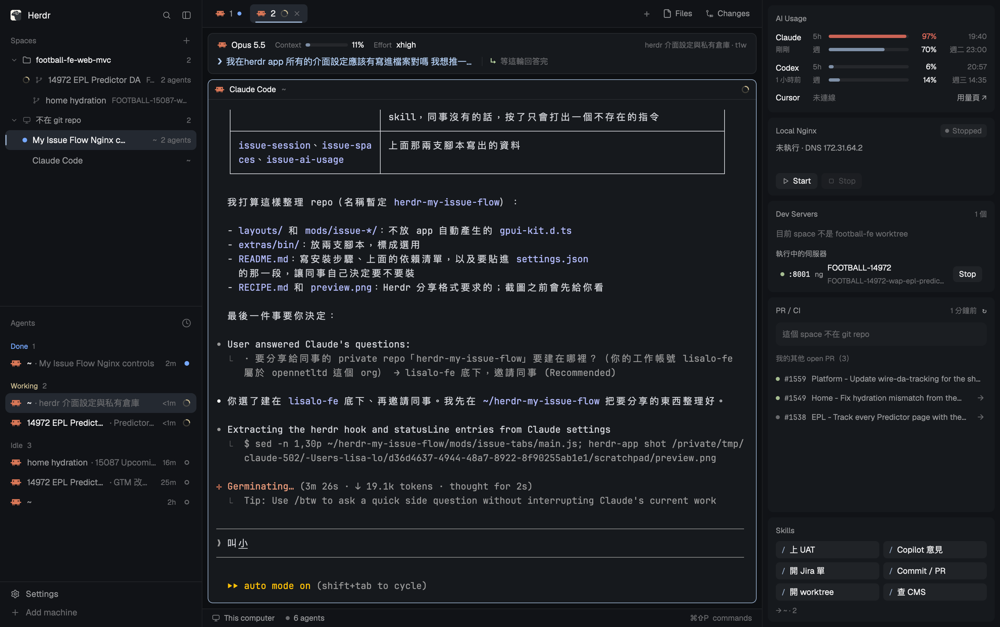

# My Issue Flow

Herdr app 的一個版面，給 football-fe 開單、改 code、上 UAT 這條流程用。



- **左側**：Space 依 git repo 和 worktree 分組；每列都顯示 agent 狀態（處理中、需要你、完成）
- **中間**：上方是 Agent Session 列，顯示目前 Claude 的模型、context 用量、effort，以及上一個問題、結論和下一步；下面是終端機
- **右側**：AI 用量（Claude、Codex）、本機 Nginx、Dev Servers、PR / CI、常用 skill 按鈕

在 Herdr app 0.1.14 上做的，macOS。

## 安裝

```bash
git clone git@github.com:lisalo-fe/herdr-my-issue-flow.git ~/herdr-my-issue-flow
cd ~/herdr-my-issue-flow

APP="${HERDR_APP_HOME:-$HOME/.config/herdr-app}"
# 不覆蓋：同名的已經存在就跳過，並印出來
for f in layouts/my-issue-flow.json layouts/my-issue-flow.svg mods/issue-*; do
  if [ -e "$APP/$f" ]; then echo "已存在，跳過：$APP/$f"; else cp -R "$f" "$APP/$f"; fi
done
for m in mods/issue-*; do herdr-app check "$APP/$m"; done

herdr-app do layout.switch '{"name":"my-issue-flow"}'
```

切回原本的版面：`cmd-shift-l`。萬一畫面壞掉，按 `ctrl-alt-shift-escape` 一定會回到預設的 `main` 版面。

### 更新

```bash
cd ~/herdr-my-issue-flow && git pull
APP="${HERDR_APP_HOME:-$HOME/.config/herdr-app}"
cp layouts/my-issue-flow.json layouts/my-issue-flow.svg "$APP/layouts/"
rsync -a --exclude gpui-kit.d.ts --exclude jsconfig.json mods/ "$APP/mods/"
```

這會蓋掉你改過的 `mods/issue-*`，像是 `issue-skills/skills.json`。有改的話，先備份。

### 移除

把 `layouts/my-issue-flow.*` 和 `mods/issue-*` 從 `~/.config/herdr-app/` 刪掉。

## 選用：讓 Agent Session 列有內容

`issue-session`、`issue-spaces`、`issue-ai-usage` 會讀 `~/.claude/herdr-sidebar/sessions/`，這個資料夾由下面兩支腳本寫入。**不裝也能用**，只是 session 列會顯示 N/A，左側也看不到 Claude 的 session 標題。

| 腳本 | 掛在哪 | 做什麼 |
|---|---|---|
| `herdr-cc-hook` | Claude Code 的 `UserPromptSubmit`、`Stop` hook | 記下你問的問題；回合結束後在背景呼叫 `claude -p --model haiku`，把這輪整理成「結論 / 下一步」兩行 |
| `ccsl-wrap` | Claude Code 的 `statusLine` | 把模型、context、用量、專案資料夾存下來，大約每 2 秒一次 |

**裝之前要知道：**

- `herdr-cc-hook` **每回合會多呼叫一次 Haiku**，算在你自己的 Claude 用量裡。執行 `touch ~/.claude/herdr-sidebar/no-llm` 可以關掉，關掉後結論改用回覆的第一句。
- `ccsl-wrap` **會取代你原本的 statusLine**。在 Herdr app 裡它不顯示任何東西，因為資訊已經在上方的 session 列。在其他終端機，只有在你裝了 `~/.local/bin/ccstatusline`，而且有 `~/.claude/.statusline-on` 這個檔案時，才會跑 ccstatusline。
- 兩支腳本都只在 Herdr 的終端機裡動作；在其他地方開 Claude Code 不會受影響。
- 需要 `python3`、`claude` CLI，以及 `/usr/bin/jq`（macOS 15 以上內建）。

**安裝：**

```bash
mkdir -p ~/.local/bin
cp extras/bin/herdr-cc-hook extras/bin/ccsl-wrap ~/.local/bin/
chmod +x ~/.local/bin/herdr-cc-hook ~/.local/bin/ccsl-wrap
```

接著**自己**把 `extras/claude-settings.snippet.json` 合併進 `~/.claude/settings.json`：

- `hooks.UserPromptSubmit`、`hooks.Stop`：加進原本的陣列，不要取代
- `statusLine`：會取代原本的設定

已經開著的 Claude session 不用重開，就會吃到新的 hook。

## 每個面板需要什麼

| 面板 | 需要 |
|---|---|
| Local Nginx（`issue-nginx`） | `~/football-fe-dev-proxy`，以及 `~/.local/bin/nginx-up`、`nginx-down`（連到 `football-agents` 的 `bin/fe-dev`）。啟動和停止需要 sudo，會開一個小視窗讓你按 Touch ID 或輸入密碼 |
| Dev Servers（`issue-dev-servers`） | `~/.local/bin/fe-up`、`fe-down`、`fe-ls`（一樣來自 `football-agents`）、tmux、`127.0.0.1:8787` 的 dev proxy；worktree 放在 `~/football-fe-web-mvc-worktrees/` |
| PR / CI（`issue-prci`） | `gh` 已登入；repo 放在 `~/football-fe-web-mvc`。只讀不寫 |
| Skills（`issue-skills`） | 按鈕只會把 `/<skill> ` 打進 Claude 的輸入框，不會按 Enter。清單在 `mods/issue-skills/skills.json`，改完面板會自己重新載入。預設的 `merge-uat` 是個人 skill，你沒有的話，請換掉或刪掉 |
| AI Usage（`issue-ai-usage`） | Claude 的用量來自 `ccsl-wrap` 存的資料，退而求其次讀 `~/.cache/ccstatusline/usage.json`；Codex 的用量讀 `~/.codex/sessions/`。只讀本機檔案，不連網路 |
| Agent Session（`issue-session`）、Spaces（`issue-spaces`） | 上面那兩支選用腳本 |

路徑寫死在 mod 裡。你的 repo 放在別的地方的話，要改對應 mod 的 `main.js`。`issue-nginx` 可以用版面裡的 `props.dir` 指定 proxy repo 的位置。

## 自己做一份

`RECIPE.md` 是給 agent 看的建構說明。照著它，可以在空資料夾從頭重建這個版面，Herdr 版本不同、這裡的檔案跑不起來時用得到。
