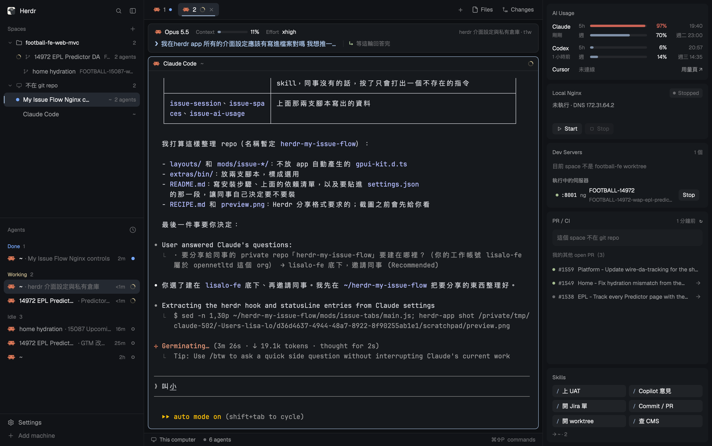

# My Issue Flow

這是一個把工作區、agent 對話與本機開發狀態放在同一眼可見範圍的 Herdr 版面：左邊按儲存庫整理 spaces 與 agents，中間是分頁終端機及目前 Claude Code session，右邊依序看 AI 用量、Nginx、Dev Servers、PR / CI 和常用 Skills。

## What you see

- 整體是 graphite 深色三欄：畫布 `#0d0f12`，左右欄 `#111317`，卡片 `#16191d`，選取底色 `#93a8c326`，重點色 `#93a8c3`，細邊框 `#ffffff12`。卡片圓角 8px，工作區卡片間距 8px；標題列不使用系統 titlebar。
- 左欄寬 268px，上方 46px 是工作區 chrome；下方兩塊等權重且各至少 90px。Spaces 先列儲存庫群組，再列主 checkout 與 worktree；列中有分支、前後進度、agent 狀態與「需要你」。不在 git repo 的 space 另成一組。Agents 是內建 agent 清單。最底 69px 是工作區 footer。
- 中欄上方 42px 是分頁：啟用項有淡藍底及 2px 底線，名稱最多顯示 170px，旁邊可有 agent 狀態及關閉鈕。下方工作區四周留 8px；先有 62px 的 session 卡，再是主要終端機 pane。session 第一列是模型、Context 進度條與百分比、Effort、session 名稱和終端機；第二列分半顯示淺藍色的問題與淺綠色的 recap。主要 pane 頂部常顯示 30px 的內建標頭，焦點邊框是重點色。底部 28px 是 workspace status。
- 中欄右側的 Files / Changes 面板預設隱藏；打開時寬 368px，可在檔案與變更兩頁之間切換。
- 右欄寬 292px、內距 8px、卡片間距 8px。AI Usage 高 162px，顯示 Claude / Codex 的 5h 與每週用量、重置時間，Cursor 一列顯示「未連線」與用量頁連結。Local Nginx 初始高 118px，顯示 Running / Stopped / Error、程序與 DNS、提醒、Start / Restart / Stop。Dev Servers 初始高 120px，顯示目前 worktree、環境選擇、啟停鈕和其他執行中的服務。PR / CI 至少高 170px 且吃剩餘空間，顯示目前分支 PR 的 review / CI，再列自己的其他 open PR。Skills 初始高 170px，兩欄排列六個常用指令按鈕：上 UAT、Copilot 意見、開 Jira 單、Commit / PR、開 worktree、查 CMS。
- 小標題用約 11.5px 中等字重，卡片內容多為 11–13px；PR 編號、port 與輸出採 JetBrains Mono。狀態色由主題提供：執行中用 `#93a8c3`，警告與錯誤用主題的對應色。

## How it behaves

- Agent `working`：space 與 tab 出現旋轉中的工作圖示，tab 使用版面的 `#c8b98f`；`blocked` / needs you：space 與 tab 顯示 blocked 色圓點，群組標頭加「需要你」數量；`done`：顯示 done 色圓點；`idle`：space 留空狀態位、tab 不加標記。群組折起時仍保留最急迫狀態或「需要你」計數。
- 點群組標頭展開或收合，點 space 切換並回到它的分頁，右鍵 space 開選單；窄欄時改成帶狀態的小編號。點 Spaces 的加號建立 space。點 tab 切換、雙擊改名、拖放換順序、右鍵開選單，啟用 tab 的叉號可關閉；tab 列上的滾輪切前後分頁，加號開新增選單。視窗有按鈕時可縮小、放大或關閉。
- 點 Files 或 Changes 顯示對應面板，再點同一鈕收起；每個 space 記住自己的面板選擇。session 列跟隨聚焦終端機；滑過問題可看較完整文字，滑過 recap 可看完整 recap 及下一步。聚焦的不是 Claude Code，或資料缺失、過期時顯示 N/A。
- AI 用量條隨本機資料更新；滑過 Cursor「用量頁 ↗」變亮，點擊在瀏覽器開啟用量頁。Local Nginx 的狀態 pill 在操作中旋轉；Start / Restart / Stop 會開 660×300 的終端機視窗供 sudo 授權，完成後重新確認程序與 :443，失敗可展開輸出或清除訊息；沒有狀態、正在操作或不適用時按鈕變暗且不能點。
- Dev Servers 選 ng / gh / ke 後記住選擇；Start 開終端機、Stop 停有 `fe-up` session 的伺服器。其他 worktree 的服務可點列跳到 space；Switch 第一次點變「確認切換」，再點才切換，逾時恢復。失敗可展開輸出；操作中的圖示與訊息會更新。
- PR / CI 的執行中檢查有旋轉圖示；點 PR 標題、PR 列或失敗檢查在瀏覽器開啟，點箭頭切到其 worktree，點 ↻ 重新讀取。Skills 按鈕 hover 有底色與完整指令提示；點擊把 `/<command> ` 輸入目前 Claude Code 終端機並聚焦，使用者自行補參數、按 Enter；agent 正等待回應對話框時按鈕停用。

## Built from

- `layouts/my-issue-flow.json`：`root` row → `sidebar` column（`brand`、`sidebar-lists` → `spaces` / `agents`、`sidebar-footer`）＋ `work` column（`tabs`、`work-body` → `work-main` → `session` / `main`，以及 `panel` → `panel-body` stack → `files` / `changes`；`status`）＋ `flow` column（`flow-usage`、`flow-nginx`、`flow-dev`、`flow-prci`、`flow-skills`）。`main` 用 active tab 與 pane 配置；`panel` 初始 `hidden: true`，stack 初始選 `files`。`layouts/my-issue-flow.svg` 是 320×200 的版面縮圖，繪出相同三欄與卡片。
- 內建 mod：`workspace-chrome` 畫左欄品牌與 footer（footer 位置有 `footer: true`）；`agents` 畫 agent 清單；`pane` 畫主要 pane 標頭；`files`、`changes` 畫可切換側面板；`workspace-status` 畫底部狀態列。
- `issue-spaces`：複製自 0.1.14 的 `spaces`，沒有 layout props；使用 spaces、panes、agents 與 git common dir 分組，讀 Claude session 的 project dir / title。`issue-tabs`：複製自 0.1.14 的 `tabs`，沒有 layout props；畫分頁、面板開關與視窗按鈕，面板選擇存 localStorage。
- `issue-session`：沒有 layout props；依 focused terminal 和 `term-<terminal>.json` 找 session，再讀 `<session_id>.status.json` / `<session_id>.json`。`issue-ai-usage`：沒有 layout props；呼叫 `usage.sh` 讀本機 Claude statusLine、ccstatusline cache 與 Codex rollout JSONL；Cursor 僅有瀏覽器連結。
- `issue-nginx`：layout props 是 `{block: "flow-nginx", height: 118, expanded: 340}`；可選 `dir`（預設 `~/football-fe-dev-proxy`），授權視窗使用 `{role: "auth", terminal, op}`。呼叫 `nginx-status.sh` 讀本 repo 的 nginx master、port、DNS 與 upstream；Start / Restart 執行 `~/.local/bin/nginx-up`，Stop 執行 `~/.local/bin/nginx-down`。若可執行檔不存在，改跑 proxy repo 的 `scripts/setup-dns.sh`、`scripts/start-local-nginx.sh` 或 `scripts/stop-local-nginx.sh`。
- `issue-dev-servers`：layout props 是 `{block: "flow-dev"}`，用來按內容呼叫 resize；授權視窗使用 `{role: "auth", terminal}`。由 `curl` 讀 `http://127.0.0.1:8787/api/nuxt-ports`，由 `~/.local/bin/fe-ls --brief` 補清單；`tmux` 判斷可停的 session，`ps` 辨認其他環境；Start 使用 `~/.local/bin/fe-up`，Stop / Switch 使用 `~/.local/bin/fe-down`。
- `issue-prci`：沒有 layout props；以 `git` 判斷目前 repo，使用 `gh pr list --author @me --state open --limit 10`、需要時 `gh pr view` 取得 PR / review / CI；`/usr/bin/open` 開連結。`issue-skills`：layout props 是 `{block: "flow-skills"}`，依 `skills.json` 的列數調整卡片；聚焦 Claude 終端機後，優先用剪貼簿配合 `herdr-app do terminal.paste` 輸入，失敗則逐鍵輸入，從不送 Enter。
- Herdr API：`spaces()`、`panes()`、`agents()`、`focused()`、`layout()`、`window()`、`settings()`、`theme()`、`props()`、`home()`、`appHome()`、`shared()`、`setShared()`、`readTextFile()`、`watchFolder()`、`exec()`、`hc()`、`run()`、`openOverlay()`、`closeOverlay()`。使用的動作包括 `space.select` / `space.new`、`tab.select` / `tab.move` / `tab.rename` / `tab.close` / `tab.prev` / `tab.next`、`pane.focus`、`layout.select` / `layout.show` / `layout.hide` / `layout.resize`、`window.minimize` / `window.maximize` / `window.close`；`hc` 使用 `run`、`wait`、`read`、`rm`、`kill`、`keys`。外部程式還有 `git`、`gh`、`tmux`、`curl`、`ps`、`/bin/bash`、`/usr/bin/open`、`pbpaste`、`pbcopy`、`/usr/bin/jq`；`nginx-status.sh` 另用 `nc`、`pgrep`、`scutil` 等本機工具。
- 選用 `extras/bin/herdr-cc-hook`：Claude Code 的 `UserPromptSubmit` / `Stop` hook，寫 session 的問題、recap、下一步；可呼叫 `claude -p --model haiku` 摘要，關閉時用回覆第一句。選用 `extras/bin/ccsl-wrap`：Claude statusLine wrapper，寫模型、context、effort 與 terminal-to-session 對應；在 Herdr app 終端機內不畫文字。兩者都寫到 `~/.claude/herdr-sidebar/sessions/`，供 session、spaces、AI usage 讀取。

## Watch out

- `preview.png` 是實際畫面截圖；`layouts/my-issue-flow.svg` 是版面配置用的 320×200 縮圖。重建時要保留兩者各自用途，不要用 SVG 縮圖覆蓋截圖。
- 左欄在 layout 裡 `resizable: false`，初始 268px、界限 44–480px；spaces 的窄欄呈現以實際寬度小於 160px 判定。右欄初始 292px、界限 240–440px。隱藏面板初始 368px、界限 280–900px。`flow-nginx` 失敗輸出可擴至 340px；`flow-dev` 與 `flow-skills` 會按內容改高度，不能只看 JSON 初始值。
- PR 其他清單只取自己的前 10 個 open PR，失敗檢查在目前 PR 卡最多列 4 個；Skills 目前有 6 項、每列 2 項。Nginx 只認 `~/football-fe-dev-proxy` 的 nginx master，不能把別的 nginx 程序當它。Dev Servers 的 Stop 只對有對應 `fe-` tmux session 的服務可用；來源不明的服務會停用該鈕。Switch 只對指定環境 port 及可停的來源服務顯示可操作狀態。
- 目前沒有作用的控制項：Cursor 用量沒有實際進度條，只有「用量頁 ↗」；Skills 只輸入 slash command，不會替人執行。`issue-ai-usage` 的 Codex 週用量取決於本機 rate limit 資料是否有 secondary window；沒有時顯示空值。
- 這份配置假設 `~/football-fe-web-mvc`、`~/football-fe-web-mvc-worktrees/`、`~/football-fe-dev-proxy`，以及 `127.0.0.1:8787` 的 dev-service、`~/.local/bin/nginx-up|down`、`fe-up|fe-down|fe-ls`、`gh` 登入、`tmux`。Nginx 操作可能要求 sudo 授權；`ccsl-wrap` 需要 `/usr/bin/jq`。選用 hook / statusLine 尚未安裝或 `~/.claude/herdr-sidebar/sessions/` 沒資料時，session 顯示 N/A，spaces 退回 live folder / space folder，AI Usage 可能顯示無資料。session 與 spaces 會忽略過期或不符 session id 的對應，不應拿舊資料填畫面。

## Done when

- 版面開啟時看到三欄：左側 repo 群組與 agents、中間 tabs / session / pane / status、右側五張依序排列的卡片；Files / Changes 面板初始收起，點任一鈕顯示、再點收起。
- 一個 space 有工作中的 agent 時能看到旋轉圖示；需要回應時有 blocked 色與群組「需要你」數量；完成時有 done 點；閒置時不出現工作標記。切換 space 與 tab 後，選取底色和底線正確移動。
- 聚焦有有效 Claude statusLine 與 hook 資料的終端機後，session 卡顯示模型、Context、Effort、問題和 recap；換到非 Claude 終端機或讓資料過期，顯示 N/A。滑過 recap 可看到下一步。
- 本機有用量資料時 AI Usage 顯示 Claude / Codex 的 5h、週用量與重置時間；點 Cursor 用量頁會開瀏覽器。Skills 點擊後在聚焦 Claude 終端機留下 slash command 與空格，沒有自動送出；blocked 時不可點。
- Nginx 卡能區分 Running / Stopped、顯示 pid、:443 與 DNS 提醒；操作時開授權終端機、結束後再次檢查狀態，失敗輸出可展開。Dev Servers 能列本機服務、切換環境選擇、只允許有 `fe-up` session 的 Stop，Switch 要二次點擊。
- 目前 worktree 有 PR 時 PR / CI 顯示 review 與成功、執行中、失敗數量；點 PR / 失敗檢查會開瀏覽器，點對應 worktree 箭頭會切換 space，↻ 會刷新。
